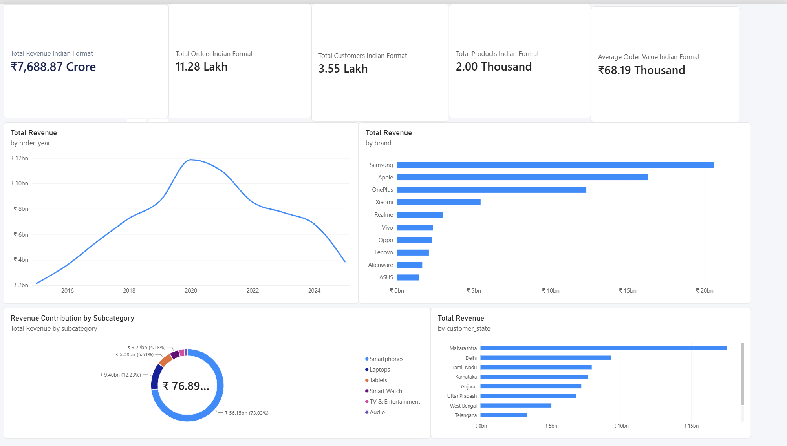
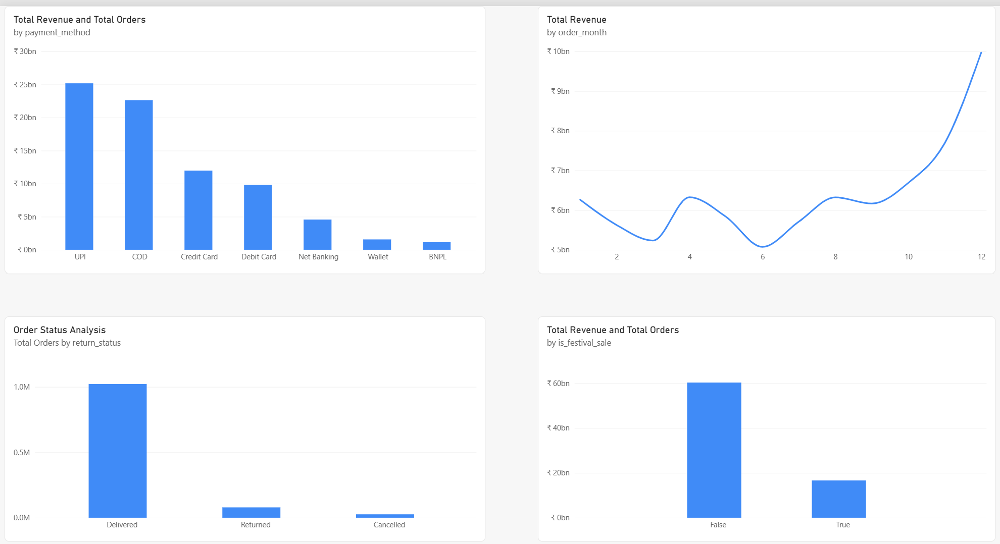
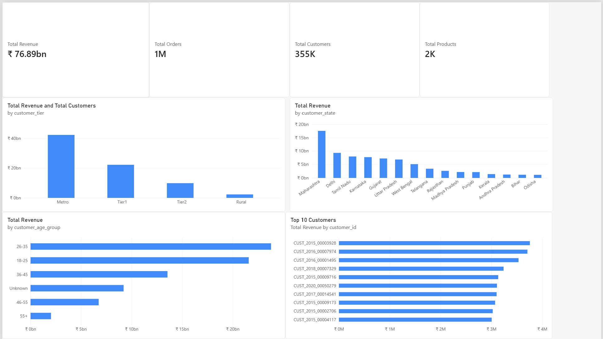
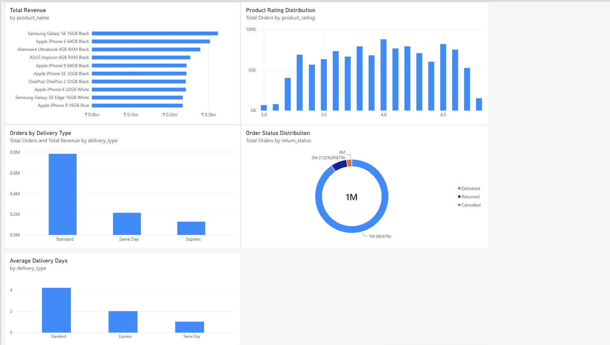

# Amazon Data Analysis (2015–2025)

An end-to-end sales analytics project using Python, Pandas, SQLite and Power BI. The project brings together annual Amazon India sales datasets from 2015 to 2025, prepares a consolidated dataset, explores sales and customer behaviour, stores the data in SQLite, and presents business metrics in a Power BI report.

> **Dataset note:** The CSV files used in this project may be mentor-provided or otherwise subject to sharing restrictions. Before making this repository public, confirm that you have permission to publish the raw data, cleaned data, database, and any derived extracts. If permission is not available, publish the code and documentation only, and explain how an authorised user can supply the data locally.

## Project objectives

- Understand the structure, quality and consistency of the annual datasets.
- Clean and standardise fields needed for reliable analysis.
- Combine annual data into one master dataset covering 2015–2025.
- Analyse revenue, orders, customers, products, brands, geography, payment methods, returns, festivals and delivery performance.
- Load the consolidated data into SQLite and perform SQL-based analysis.
- Present key metrics and trends in an interactive Power BI report.

## Project snapshot

| Item | Project detail |
|---|---|
| Period | 2015–2025 |
| Annual source files | 11 yearly CSV datasets |
| Consolidated dataset | `amazon_master_2015_2025.csv` |
| Master dataset shape | 1,127,609 rows × 34 columns (as recorded in the project notebook) |
| SQL database | SQLite — `database/amazon_database.db` |
| SQL table | `amazon_sales` |
| BI report | `Amazon_Dashboard.pbix` |

The project analysis recorded the following full-dataset metrics. Recheck them after any data or measure changes before using them in a final presentation:

| Metric | Recorded result |
|---|---:|
| Total revenue | ₹76,888,729,563.25 (approximately ₹7,688.87 crore) |
| Total transactions/orders | 1,127,609 |
| Unique customers | 354,969 |
| Unique products | 2,004 |
| Average order value | Approximately ₹68,187.40 |

**Metric definition note:** The notebook and Power BI measure definitions should be checked together before interpreting `transaction_id` as an order count. This README uses the recorded project totals and does not independently re-run the complete dataset.

## Technology stack

- **Python** — analysis and data preparation
- **Pandas** — data loading, cleaning, transformation and aggregation
- **NumPy** — numerical operations
- **Matplotlib** — exploratory visualisation
- **SQLite** — relational storage and SQL analysis
- **Power BI Desktop** — interactive dashboard and reporting
- **Jupyter Notebook / VS Code** — development environment

## Repository structure

```text
Amazon_Data_Analysis/
├── data/
│   ├── raw/                 # Original annual CSV files (share only if permitted)
│   └── cleaned/             # Cleaned annual files and consolidated master CSV
├── database/
│   └── amazon_database.db  # SQLite database (can be regenerated)
├── notebook/
│   ├── amazon_analysis.ipynb
│   ├── amazon_data_cleaning.ipynb
│   ├── amazon_2017_analysis.ipynb
│   ├── exploratory_data_analysis.ipynb
│   └── 03_sql_database_integration.ipynb
├── Amazon_Dashboard.pbix
├── README.md
├── PROJECT_DOCUMENTATION.md
├── requirements.txt
└── .gitignore
```

The local `.venv/` virtual environment is intentionally excluded from version control. The database and data folders shown above are project outputs/input locations; only include their contents in a public repository if sharing is authorised.

## Project workflow

1. **Dataset understanding and profiling** — inspect columns, shapes, data types, missing values, duplicates, category distributions and consistency of customer/product attributes.
2. **Data cleaning** — standardise inconsistent formats and categories, handle missing values according to business meaning, parse dates, validate numeric fields and save cleaned yearly datasets.
3. **Master dataset creation** — concatenate the cleaned yearly files into `data/cleaned/amazon_master_2015_2025.csv`.
4. **Exploratory Data Analysis** — aggregate and compare revenue and transaction measures across time, products, brands, customers, locations, payment methods, return status and delivery dimensions.
5. **SQL integration** — load the master dataset into SQLite as `amazon_sales`, then run analytical queries and create indexes for commonly queried fields.
6. **Power BI reporting** — connect the consolidated data and build report pages for executive overview, sales/payment, customers, and product/operations analysis.

## Data cleaning covered

The cleaning notebooks include checks and transformations for:

- Missing values and duplicate rows / transaction identifiers.
- Customer age group and festival-name missing values.
- Customer-rating strings (for example, values containing `stars` or `/5`) converted to numeric values where possible.
- Currency symbols, commas and text prefixes in price fields before numeric conversion.
- Category spelling/capitalisation variants.
- City-name spelling and naming variants.
- Date parsing and validation.
- Price and other numeric-field validation.
- Rechecking cleaned outputs and combining the annual files.

Missing values are not all treated the same: some are retained where the value is unknown (for example, an unavailable customer rating), while fields with a clear business interpretation may receive a category such as `Unknown` or `Not Applicable`. Review the cleaning notebook for the exact rule applied to each column.

## Exploratory analysis

The EDA notebook includes analyses such as:

- Year-wise and time-based revenue trends.
- Revenue by category, subcategory, brand and product.
- Top customers and state-wise revenue.
- Payment method performance.
- Return-status analysis.
- Festival and non-festival sales.
- Delivery type and average delivery-day analysis.
- Customer tier, age-group and rating analysis.
- Product rating distribution.

## SQL integration

The SQL integration notebook:

- Reads the consolidated master CSV.
- Creates/opens `database/amazon_database.db` using Python's built-in `sqlite3` module.
- Loads the data into the `amazon_sales` table using Pandas `to_sql`.
- Performs SQL analysis using the database.
- Creates indexes on `customer_id`, `order_date` and `brand`.

The database can be recreated from the master CSV by running `notebook/03_sql_database_integration.ipynb` after the required data files are in place.

## Power BI report

The Power BI file is `Amazon_Dashboard.pbix`. The report contains four analysis pages:

1. **Executive Overview** — KPI cards, year-wise revenue, brand performance, subcategory contribution and state-wise revenue.
2. **Sales and Payment Analysis** — payment method, monthly revenue, festival/non-festival sales and order status.
3. **Customer Analysis** — customer tiers, age groups, customer counts and top customers.
4. **Product & Operations Analysis** — product revenue, product ratings, delivery type, order status and delivery time.

Open the PBIX file with Power BI Desktop. An online report link can be added here after it is published using an approved sharing method. Do not use a public Publish to web link for confidential or restricted data.

## How to run locally

1. Install Python (the notebooks were developed in a Python 3.13 environment).
2. Clone or download this repository.
3. Place the authorised annual source CSVs in `data/raw/` using the expected filenames, for example `amazon_india_2015.csv` through `amazon_india_2025.csv`.
4. Create and activate a virtual environment (optional but recommended).
5. Install dependencies:

   ```bash
   python -m pip install -r requirements.txt
   ```

6. Open the project in VS Code or Jupyter.
7. Run the notebooks in this order:
   - `notebook/amazon_analysis.ipynb` — initial data understanding and profiling.
   - `notebook/amazon_data_cleaning.ipynb` — cleaning and master dataset generation.
   - `notebook/amazon_2017_analysis.ipynb` — year-specific 2017 analysis/cleaning work.
   - `notebook/exploratory_data_analysis.ipynb` — EDA using the master dataset.
   - `notebook/03_sql_database_integration.ipynb` — SQLite integration and SQL analysis.
8. Open `Amazon_Dashboard.pbix` in Power BI Desktop and refresh the source if required.

**Important:** Notebook paths are relative to the notebook folder. Keep the documented folder layout, or update the paths if you reorganise the project.

## Current status and future improvements

- Core Python data understanding, cleaning, EDA and SQL integration work has been developed.
- The four-page Power BI report has been created.
- Remaining project work includes final dashboard styling, adding and testing slicers/interactions, validating Power BI totals against Python and SQL, and preparing final presentation material.

## Power BI Dashboard

The Power BI report contains four interactive analytical pages.

### 1. Executive Overview



### 2. Sales and Payment Analysis



### 3. Customer Analysis



### 4. Product and Operations Analysis



## Author

Bhagyalakshmipriya.R


